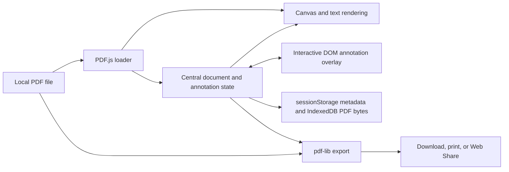

# Browser PDF Annotator

A client-side PDF editor for reviewing documents, placing annotations, and exporting the result without a server-side document pipeline.

## Overview

This project explores the engineering behind an in-browser PDF annotation workflow. I built the document-loading and rendering pipeline, interactive annotation layer, editing history, session persistence, search and navigation UI, and annotated-PDF export path.

The application keeps the original PDF bytes separate from normalized annotation state. PDF.js renders the active page and its text layer, HTML overlays provide interactive editing, and pdf-lib writes those annotations into a new PDF for download, printing, or sharing.

## Features

- Open PDFs with the file picker or drag and drop.
- Navigate with page controls and thumbnails; zoom by controls, direct input, or modified mouse wheel.
- Search document text and move between matches.
- Add freeform or text-anchored highlights, sticky notes, text boxes, and images.
- Move and resize annotations with edge, grid, and alignment-guide snapping.
- Undo, redo, and jump to an entry in a 100-state edit history.
- Restore the current document and annotations during the browser session.
- Export an annotated PDF, print it, or use Web Share where the browser supports file sharing (with download fallback).

## Technical Highlights

- **Separated render and edit layers.** PDF.js paints each page to a high-DPI canvas and builds a selectable text layer; annotation-specific modules render editable DOM elements over the same measured viewport.
- **Resolution-independent annotation geometry.** Positions and dimensions are stored as page-relative values, then denormalized for the current canvas. This preserves placement across zoom levels and responsive layout changes.
- **Serialized rendering.** The controller allows one PDF.js render task at a time and coalesces overlapping requests into one follow-up render, avoiding concurrent work against the same canvas.
- **Text-aware highlighting and search.** The text pipeline caches extracted content, maps DOM selections to character offsets, and records anchors alongside highlight rectangles so selections can be reconstructed after rendering.
- **Transactional edit handling.** Mutating handlers begin a history operation, commit and schedule persistence only after synchronous or asynchronous success, and leave failed operations uncommitted.
- **Defensive browser persistence.** Annotation metadata is debounced into `sessionStorage`, raw PDF bytes are stored in IndexedDB, and storage access is guarded so restricted storage does not break editing. Unload handling warns when in-memory work may be lost.
- **Export without rasterizing the document.** pdf-lib reloads the source bytes and draws highlights, text/notes, and supported images onto PDF pages, retaining the underlying PDF rather than converting each page to a screenshot.
- **Performance-conscious UI.** The initial HTML reserves toolbar space to reduce layout shift, canvases account for device pixel ratio, resize-driven fit calculations are debounced, thumbnails cap their render DPR, and Vite splits PDF.js and pdf-lib into separate vendor chunks.
- **Focused automated checks.** Vitest covers filename handling, history branching and jumps, preference persistence, and failure-safe handler wrapping. Playwright covers keyboard guide toggling, app-shell accessibility, and collection of Largest Contentful Paint in a production preview.

## Architecture



`src/app/controller.js` coordinates document lifecycle, page rendering, navigation, tools, and persistence. `src/pdf/` owns loading, viewport measurement, canvas/text rendering, and export. `src/ui/overlay/` isolates annotation placement and interaction by type, while toolbar and thumbnail modules translate user actions into controller handlers. `src/app/state.js` is the shared state boundary used by those components.

## Tech Stack

- JavaScript ES modules, HTML, and CSS
- Vite 7
- PDF.js (`pdfjs-dist`) 5
- pdf-lib 1
- Vitest 3
- Playwright 1
- Browser APIs: Canvas, IndexedDB, Web Share, File, and session/local storage

## Getting Started

No Node.js version is pinned in the repository. Use a Node.js/npm environment compatible with Vite 7, then install the locked dependencies:

```bash
npm install
npm run dev
```

Open the local URL printed by Vite and select or drop a PDF into the viewer. All document processing is performed in the browser.

Available verification commands:

```bash
npm run test:unit
npm run build
npm run test:lcp
```

The general Playwright suite expects the development server to already be available at `http://localhost:5173`:

```bash
npm run dev
# In another terminal:
npm run test:e2e
```

## Demo

Screenshot coming soon.

## Project Status

**Learning Project.** The implemented editor is suitable for local experimentation. There is no deployment configuration or production-readiness claim in this repository. Planned portfolio work is limited to adding a checked-in screenshot or demo.

## What I Learned

- A PDF editor needs one coordinate model shared by canvas rendering, text selection, editable overlays, thumbnails, and final PDF page coordinates; normalized geometry keeps those systems aligned through zoom and resize.
- Browser state needs different storage strategies by payload: synchronous metadata is useful during lifecycle events, while PDF byte arrays belong in asynchronous IndexedDB.
- Undo/redo is more reliable when edits have explicit begin/commit boundaries and failed asynchronous operations cannot enter history or trigger autosave.
- Text selection over PDF.js output requires stable character offsets and careful mapping between DOM ranges and page-relative rectangles; visual rectangles alone are insufficient for search-aware highlights.
